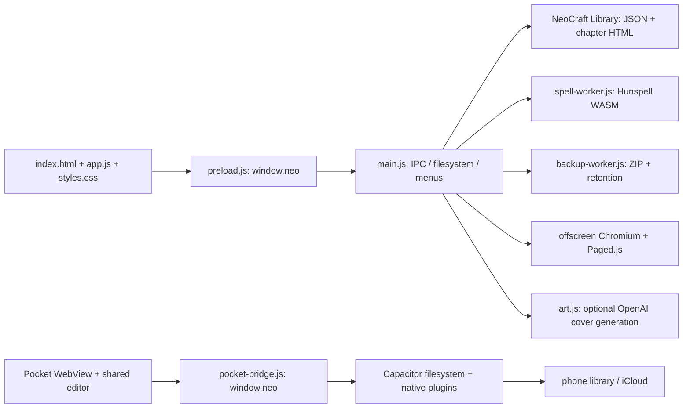
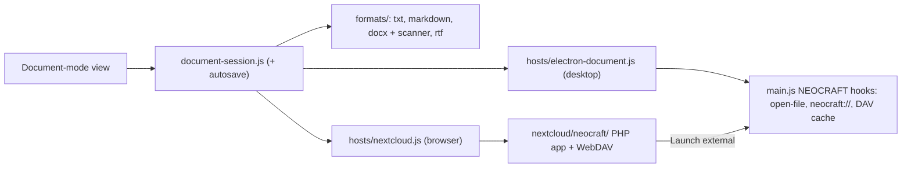

# Neo / NeoCraft code map

Describes commit: `7da01af` (2026-10-28). Line numbers below were re-checked against that commit's `main.js` and `app.js`; the generated SYMBOL-INDEX.md and the bug report still carry the older baseline (`3f21d09`, 2026-10-24), so their line numbers sit about 4 to 60 lines earlier. Proposed Nextcloud modules are in NEXTCLOUD-PLAN.md; seven small ones have landed (see "NeoCraft modules on main"), the rest do not exist yet.

**Who owns what.** Upstream (hughhowey/neo) owns the editor, the library and book code, the exporters, Pocket and the build scripts: `app.js`, `main.js`, `preload.js`, `index.html`, `styles.css`, `manuscript.js`, `covers.js`, `art.js`, `i18n.js`, `locales/`, `spell-*.js`, `backup-worker.js`, `print/`, `pocket/`, `dictionaries/`, `fonts/`, `scripts/` (upstream's tests and tools) and the other files in the first tables below; it is merged into `main` monthly. Our fork adds new files (the modules listed under "NeoCraft modules on main" and "Planned 1.0 modules", with their `scripts/*.test.js`), small `// NEOCRAFT:` hooks in `main.js`, and the identity, build and pipeline files (`package.json` build block, `.github/workflows/`, `PIPELINE.md`, `SPEC.md`, `ROADMAP.md`, `CHANGELOG.md`, `AGENTS.fork.md`, this folder).

## Runtime and data flow



Desktop uses contextIsolation and disables nodeIntegration. Browser-facing methods are in preload.js; storage work belongs in main.js. Pocket implements a second host API while copying the same editor code at build time. UI behavior is mostly a single 18,373-line file; main.js is 3,385 lines. Small independent modules already exist for covers, localization, spelling normalization and manuscript export, and the fork's pure modules (merge, flush barrier, formats, conflict copy, handoff, excluded folders) sit beside them, not yet called from the app.

## Entry points and major files

| File | Responsibility / useful starting point |
|---|---|
| `package.json` | Electron entrypoint, scripts, dependency/build configuration, product identity and updater publishing |
| `index.html` | Desktop DOM, CSP, scripts, shelf/editor/auxiliary panes; tightly coupled to app.js selectors |
| `preload.js` | Complete desktop `window.neo` API, IPC invoke/send/event mapping; synchronous initial locale/paper data |
| `main.js:15` | IPC error wrapper; logs and reports failures without changing handler timing |
| `main.js:47` | Library root selection, settings, language and writable-folder fallback |
| `main.js:382` | libName/bookDir boundaries; one-segment names, not symlink containment |
| `main.js:396` | Human-readable catalog regeneration |
| `main.js:447` | Rename retry, durable replace, fsync, JSON spare recovery |
| `main.js:490` | iCloud placeholder detection/download/wait; rebuild metadata at :616 |
| `main.js:645` | Library, book, chapter, auxiliary, snapshot, sidecar and cover IPC handlers |
| `main.js:1047` | Secret storage; cover painting starts at :1082 |
| `main.js:1179` | PDF window; ZIP export at :1271, export IPC at :1286 |
| `main.js:1327` | KDP geometry/hyphenation, Paged.js layout, exact page boxes and cover templates |
| `main.js:1701` | DOCX style/run importer; text decoder :1834; importFile :1849 |
| `main.js:2101` | Delayed backup utility-process orchestration |
| `main.js:2159` | Window setup; spelling request orchestration :2293; menus later in file |
| `main.js:3154` | Update lifecycle and fallback release queries; final section starts app/window lifecycle |
| `manuscript.js` | Pure model-to-DOCX parts / HTML export, font/paper/word-count/header rules; shared Node/browser module |
| `covers.js` | Seeded canvas cover rendering and title typography in renderer |
| `art.js` | Manuscript excerpt → brief → painted image, optional external API calls |
| `i18n.js`, `locales/` | Translation interpolation and regional fallback; English phrases are keys |
| `spell-worker.js`, `spell-ro.js` | Serialized Hunspell load/check/suggest/add and Romanian normalization |
| `backup-worker.js` | Bounded read waits, cloud exclusions, in-memory ZIP, durable output and retention |
| `styles.css` | Shared presentation tokens, book/editor/outline/print/accessibility styling |
| `print/` | Vendored Paged.js and TeX hyphenation engine/patterns; external code, not independently audited here |

## app.js navigation by section

| Line on main | Feature and main concerns |
|---|---|
| 190 | Global library/book state, saved baselines, pending writes and device look |
| 728 | Bookshelf rendering, author/shelf/book operations |
| 1206 | Bound shelves, special pages and page sheets (separate save path) |
| 2536 | Open book and render chapters; hydrate chapter and sidecar state |
| 2872 | Typing, selection, paragraph transformations, normalization and paste |
| 3947 | Poetry/flush paragraph behavior; keyboard and style helpers follow |
| 5147 | Optional Vim-style movement |
| 5584 | Screenplay model, scenes, line classes, pagination and Fountain/FDX conversion |
| 7229 | Footnotes embedded in chapter HTML |
| 7458 | Placeholders/stickies and navigation |
| 7672 | Navigation pane and chapter operations |
| 8104 | Per-book and per-chapter notes pages |
| 8465 | Manuscript/Notes/Outline/Darlings tabs and editor swapping |
| 8811 | Structured outline and chapter/section relationships |
| 9238 | Outline cards, moving held writing, loose cards and scene/chapter manipulation |
| 12054 | Word, page and daily counters, goals integration |
| 12278 | Saving: diskKnown, chapterChain, persistChapter, metaSig, flushAllSaves |
| 12458 | Differential snapshots, manifests, retention and restore UI |
| 13044 | refreshFromDisk: chapter stamps, metadata/sidecar reconciliation, conflict twins |
| 13348 | Structural undo/redo, preservation of writing changed since snapshots |
| 13683 | Native speech synthesis read-aloud |
| 13868 | Find/replace and non-persisted CSS highlights |
| 14164 | Import-to-book UI and conversion |
| 14325 | Spellcheck pass, suggestions and typewriter scrolling |
| 14801 | Focus mode |
| 14974 | Goals/sprints/charts, then cover-art settings at 15028 |
| 15219 | Help, fonts and menu message handling |
| 15624 | Export/email entrypoints; manuscript format at 15749 |
| 15955 | Paperback/KDP and other export-building helpers |
| 18039 | Error reporting; Linux font handling, accessibility at 18101 |
| 18285 | Simple NEO feature gating and settings migration |

## Persistence model and ownership

```
NeoCraft Library/
 library.json               authors, shelves, custom words, shared preferences
 _catalog.txt               regenerated folder/title map
 neo-errors.log
 Backups/neo-backup-*.zip    daily worker archive; snapshots excluded
 Exports/                   emailed snapshots
 book-<slug>-<id>/
  book.json                 chapterOrder, titles/kinds, notes/cards, position, counts
  chapters/<id>.html        manuscript, persisted semantic classes/attributes
  notes.html / outline.html
  notes-<chapter>.html      per-chapter notes
  darlings.json / stickies.json
  cover-* / art-* / art.json
  snapshots/<stamp-kind-...>/
   snapshot.json            order/titles/kinds + hashes and changed chapter set
   <chapter>.html           changed chapter content, inherited from prior snapshots
```

Desktop settings/secrets live in Electron userData, outside the library. Appearance also lives per device in localStorage. Core renderer state uses `chapterHTML` for current edits, `savedHTML` for the scheduled/saved baseline, and `diskKnown` for acknowledged/read content. `persistChapter` serializes per chapter and preserves rejected disk versions as twin chapters. `refreshFromDisk` polls stamps and reconciles metadata/chapter changes; auxiliary notes have a different pending-write path. These differences explain several review findings.

Snapshots hold chapter history and chapter shape, not a complete backup of every sidecar/setting. Backups omit snapshots. Structural undo is an in-memory action history; it is not the same as either persistence mechanism. Keep these three recovery contracts distinct during refactoring.

## Mobile host

| Area | Role |
|---|---|
| `scripts/pocket-www.js` | Copies shared UI/assets/locales; rewrites Hunspell browser import; collects dictionaries from main.js list |
| `pocket/www/index.html` | Mobile DOM, mobile menu and keyboard UI; loads shared editor/bridge |
| `pocket/www/pocket-bridge.js` | Filesystem host, iCloud locator, mobile export/share, spell engine, keyboard and back handling |
| `pocket/www/pocket-spell.js` | Browser worker/direct module implementation of spelling messages |
| `pocket/www/pocket.css` | Mobile layout/keyboard adaptations |
| `pocket/ios/App/App/LibraryHome.swift` | iCloud/local library selection, fetch and keyboard helpers |
| `pocket/ios/App/App/NeoPdf.swift` | WKWebView → native PDF and sharing URI |
| `pocket/ios/App/App/{AppDelegate,SceneDelegate}.swift` | App/scene lifecycle and Capacitor wiring |
| `pocket/android/.../MainActivity.java` | Capacitor lifecycle, keyboard/back behavior and plugin registration |
| `pocket/android/.../NeoBarsPlugin.java` | Android system bar appearance and hardware keyboard information |
| `pocket/android/.../NeoPdfPlugin.java` | WebView/native print manager export |
| `pocket/capacitor.config.json`, native manifests/build files | Platform identifiers, entitlements, permissions and distribution |

## Verification and release tooling

`npm test` runs `scripts/*.test.js` (39 files on main) with node:test, mostly using VM-extracted functions or mocked Electron plus real temporary files. Suites cover filesystem/durability/cloud behavior, sync/daily counts, typing/paste, screenplay/import, spelling, snapshots, formatting, manuscript and print rules, the page-sheet save path (`page-sheet-save.test.js`) and the fork's pure modules (`meta-merge.test.js`, `meta-merge-library.test.js`, `flush-barrier.test.js`, `markdown-frontmatter.test.js`, `wikilinks.test.js`, `conflict-copy.test.js`, `handoff.test.js`, `excluded.test.js`). Several of the fork's tests are locked tests added with their issues; do not edit them to make a build pass. `npm run lint` runs oxlint with `.oxlintrc.json` (`print/` ignored). `*.e2e.js` (`npm run test:words`, `test:tabs`, `test:notes` and the like) are separate Electron-driven integration scripts and are not part of npm test. They need a working Electron environment/assets, and each now builds its temporary library as `NeoCraft Library` to match the fork's library folder name (`DEFAULT_LIBRARY_NAME` in `main.js`). `scripts/fixtures/` holds the Fountain/FDX samples the screenplay tests read. Read the bug report for actual run results and restrictions.

`.github/workflows/build.yml` ("Build NeoCraft") builds desktop on version tags/manual dispatch, checks tag/package agreement, smoke-tests the Windows build (it looks for a `NeoCraft` process and `NeoCraft Library/library.json`) and attaches draft release artifacts: Windows NSIS + portable x64, macOS dmg + zip for arm64 and x64 (unsigned: `identity: null`, no notarization, no signing secrets), Linux AppImage for x64 and arm64 (the `linux` build block lists both). `pocket.yml` builds native Pocket; its release notes now point bug reports at the fork. Neither is PR unit/lint CI: PR checks are #16, not yet built. `scripts/release.js`, `bundle.js` and `try.js` are upstream maintainer delivery tools; do not invoke them as part of reviewing or generating documents because they can push/release. `scripts/i18n.js` refreshes/checks string catalogs. This review adds only documentation plus a temporary-library diagnostic script in this folder, not production behavior.

## Change routing

- Save/conflict/recovery changes: app saving/refresh + main filesystem handlers + Pocket host, with injected-failure tests.
- Book formatting: app typing/captureBody + CSS + export serializers; verify that transient UI marks never enter chapter HTML.
- New host capability: explicit API and capability contract, adapter, call site and parity test. Document mode should use a smaller dedicated interface.
- Nextcloud conversion: new document core/formats/host/app modules; keep books on their existing API while fixing reviewed defects. Do not expose the Electron bridge directly to a web page.

## NeoCraft modules on main

Pure, dependency-free modules the fork has merged so far (2026-10-27 and 2026-10-28). Each is a classic script that sets a browser global and also `module.exports` in Node; each has a locked test in `scripts/`. **None is called from `app.js`, `main.js`, `preload.js`, `index.html` or Pocket yet**; the issues that wire them in are the "Planned 1.0 modules" rows below.

| Path | Status | Owns | Used by (planned) | Issue / test |
|---|---|---|---|---|
| `meta-merge.js` | present | `mergeOrder(base, local, remote)` (chapter order; a local addition anchors on its nearest preceding id), `mergeBookMeta` (book.json fields; `chapterOrder`, `modified` and `revision` are resolved, not conflicts), `mergeLibrary` (library.json: authors, shelves, custom words, preferences) | `book:writeMeta` in `main.js` (#39) and `library:write` (#40) | #37, #38; `meta-merge.test.js`, `meta-merge-library.test.js` |
| `flush-barrier.js` | present | `createFlushBarrier({ setTimer, clearTimer })`: `track(promise, label)`, `pending()`, `flush(timeoutMs)`; reports late and early rejections and times out late writes | desktop close/quit waiting for acknowledged saves (#43), recovery drafts (#44) | #42; `flush-barrier.test.js` |
| `formats/markdown-frontmatter.js` | present | `splitFrontmatter(text)` / `joinFrontmatter(parts)`: BOM, frontmatter and body held apart, byte-exact | `formats/markdown.js` (#49) | #46; `markdown-frontmatter.test.js` |
| `formats/wikilinks.js` | present | `findWikilinks(text)`: `[[links]]` with exact source spans, skipping code | `formats/markdown.js` (#49) | #48; `wikilinks.test.js` |
| `hosts/conflict-copy.js` | present | `conflictCopyName(fileName, date, attempt)` and `createExclusive({ fetch, folderUrl, fileName, bytes, date, requestToken })`, which PUTs a conflict copy with If-None-Match so it never overwrites | `hosts/nextcloud.js` (#58), `hosts/electron-document.js` | #57; `conflict-copy.test.js` |
| `desktop/handoff.js` | present | `createIntent` and `createIntentVerifier`: single-use, expiring `neocraft://` handoff intents | Launch external (#77) | #75; `handoff.test.js` |
| `nextcloud/neocraft/src/excluded.js` | present | `normalizePath`, `isExcludedPath(path, excluded)`: excluded-folder matching for the Nextcloud app | the PHP app's file actions and "+ New" (#66, #67) | #64; `excluded.test.js` |

Fork hooks in upstream files, all marked `// NEOCRAFT:` in `main.js`: app name (`:34`), library folder name `NeoCraft Library` via `DEFAULT_LIBRARY_NAME` (`:44-45`, used in the chooser, fallback and startup paths), and the update check that queries `iannitram/neo` releases, never upstream (`:3164`, `:3210`). Also changed for the fork: `package.json` (`productName` NeoCraft, `appId com.iannitram.neocraft`, publish to `iannitram/neo`) and the `build.yml` / `pocket.yml` text above. `app.js` has no NEOCRAFT hooks; its fork-era changes are upstream's merged fixes plus the bound-shelf page-sheet save fix (#12, `openPageSheet` at :1653, covered by `page-sheet-save.test.js`).

## Planned 1.0 modules

Added 2026-10-26 for the approved spec ([SPEC.md](../../SPEC.md)). Rows marked *planned* do not exist on main; each names the issue that creates it. Modules that have since landed are listed in "NeoCraft modules on main" above and only referenced here. Child issues (#32-#78) split several rows into smaller files, named in the notes. Layout follows [NEXTCLOUD-PLAN.md](NEXTCLOUD-PLAN.md), "Architecture decision".

| Path | Status | Owns | Calls / called by | Issues |
|---|---|---|---|---|
| `document-session.js` | planned | One open file: original bytes, base revision, dirty and saved generations, fidelity report, serial saves, recovery draft | called by the Document-mode view; calls a format adapter and a storage host | #18 |
| autosave scheduler (in the session) | planned | When to save: after a typing pause and on close | called by the session; calls `host.save` | #30 |
| `editor/` | planned | Editing behaviour extracted from `app.js` (typing, quotes, dashes, find, spellcheck), without book-only commands | used by the Document-mode view; `app.js` keeps books | #18 |
| `formats/txt.js` | planned | .txt reader/writer keeping line endings, BOM and encoding | used by the session | #19 |
| `formats/markdown.js` | planned | Byte-faithful .md: source spans, frontmatter held aside, wikilinks; builds on the landed `formats/markdown-frontmatter.js` and `formats/wikilinks.js`, and on the planned `formats/span-patch.js` (#47) | used by the session | #20, #49 |
| `formats/docx.js` + fidelity scanner (issues split it into `formats/docx/{limits,scan,read,write}.js`) | planned | Simple .docx read, package-patching write; lists features it cannot keep | used by the session; the scanner result drives the fallback | #21 |
| `formats/rtf.js` (issues split it into `formats/rtf/{tokenize,scan,read,write}.js`) | planned | Bounded .rtf reader/writer with the same scanner | used by the session | #23 |
| `hosts/nextcloud.js` | planned | Browser storage host (reuses the landed `hosts/conflict-copy.js`; guarded PUT in `hosts/dav-save.js`, #56): authorized reads with ETag, If-Match saves, 412 -> exclusive copy | called by the session in the browser; talks to the `neocraft` PHP app and WebDAV | #22 |
| `hosts/electron-document.js` | planned | Desktop storage host: open by exact path, modified-time check, atomic replace, recovery | called by the session on the desktop; uses `main.js` over a small preload bridge | #25 |
| `main.js` hooks (`// NEOCRAFT:`) | partial: identity, library folder and update-feed hooks only | open-file / CLI / second-instance handling, `neocraft://` protocol, account and sync-folder mapping, WebDAV cache | calls `hosts/electron-document.js`; reads the Nextcloud client config | #25, #26 |
| `nextcloud/neocraft/` | partial: only `src/excluded.js` (#64); no `appinfo/`, PHP or page yet | The Nextcloud PHP app: page route, authorized file operations, conflict copy, Files/Viewer actions, "+ New", excluded-folder delegation to Text, fallback to Collabora | serves the browser editor; called by Files | #17, #22, #24, #31 |
| `neocraft-bugreport.js` (loaded first by `index.html` and by the Nextcloud page) | planned | Report a bug: starts craft-bugreport-web's error buffer, mounts its standalone `mountReportButton` (the module bundles its own Vue; NEO stays framework-free), passes config and `getWorkingFile()` (the open document, as is). Desktop config comes from Electron settings through a new `window.neo.getBugReportConfig()` in `preload.js` (IPC to `main.js`); browser config from the `neocraft` PHP app's initial state | called by `index.html` / the Nextcloud page; calls the module, `preload.js` | #83, #84, #85 |
| `nextcloud/neocraft/appinfo/info.xml` + `.github/workflows/release.yml` (updates from the admin panel) | planned | The release fields the merged feed reads (id `neocraft`, a.b.c version, Nextcloud 33 range, PHP minimum; guarded by `scripts/neocraft-infoxml.test.js`) and a tag workflow that calls the app-store repo (private)'s `build-app.yml@v1` with `app_dir: nextcloud/neocraft`; signing and publishing on the release-key machine (R35), never in CI. Desktop releases are unchanged (D8) | called on version tags | #86, #87, #88 |
| build and release config (`package.json` `build`, `.github/workflows/`) | partial: NeoCraft identity, own update feed and unsigned three-OS tag builds are in (#8); PR tests (#16) are not | NeoCraft identity, app id, own update feed, unsigned three-OS builds, PR tests | used by CI | #8, #16 |



### Mac, PC and Linux

- **Formats, session and editor** are plain JS with no OS code; their Node tests (the modules on main already have them) are plain node:test and run on any OS; no CI job runs them on a push or PR yet, that is #16. Tag builds on all three OSes already work (`build.yml`).
- **Windows:** NSIS + portable builds, x64 only (the only job that smoke-tests the installed app); the Nextcloud client config is `%APPDATA%\Nextcloud\nextcloud.cfg`; SmartScreen warns on first launch (accepted, D8).
- **macOS:** dmg and zip for arm64 and x64, unsigned (`identity: null`, no notarization) (right-click > Open); `open-file` events; the client uses File Provider placeholders, so open the exact path and never scan the folder; config in `~/Library/Preferences/Nextcloud/nextcloud.cfg`.
- **Linux / SteamOS:** AppImage, x64 and arm64 in `package.json` (the `.zsync` delta file is #103); the AppImage does not register `neocraft://` by itself, so the launcher installs a `.desktop` entry with `x-scheme-handler/neocraft`; the Flatpak client config is under `~/.var/app/com.nextcloud.desktopclient.nextcloud/config/Nextcloud/`.
- **Browser:** the `neocraft` app targets Nextcloud 33; tested in a disposable server only.

### Open-source pieces

Upstream NEO itself (MIT; keep the credits), electron-builder (already used), Nextcloud's app scaffold and frontend tooling for the PHP app (NEXTCLOUD-PLAN.md), a maintained RTF parser for reading (#23 picks it after a licence check), and Nextcloud Login Flow v2 plus Electron `safeStorage` for the desktop app password (#26).
